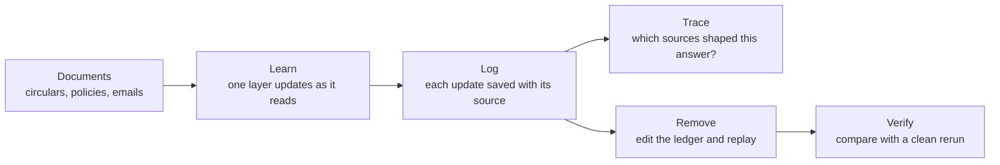

# STARK

**Self-Taught, Auditable and Reversible Knowledge for Language Agents**

[Overview](#overview) · [How it works](#how-it-works) · [Research questions](#research-questions)

---

STARK is an auditable language agent that learns while it works, records every update in a lesson ledger, and helps bank compliance teams control what it knows by tracing any answer to its sources, removing any source exactly, and checking each removal against a clean rerun, all without retraining the model.

## Overview

Language models that update their own weights during use can keep up with a rulebook that keeps changing. But they keep no record of what each input taught them. A forged notice, a customer's private record or a withdrawn circular can become a lasting part of the model's behaviour, and today the only fix is to wipe everything it has learned.

STARK keeps a ledger of every update. Any answer can be traced to the inputs behind it, and any input can be removed so the model matches, up to rounding, one that never read it.

| Property | What it means |
| --- | --- |
| **Self-taught** | Updates one small layer of its own weights as it reads, with the model as its own teacher |
| **Auditable** | Logs every update with the input that caused it |
| **Reversible** | Removes any input exactly, including its indirect influence on later updates |
| **Low cost** | Only one matrix learns; the backbone stays frozen and updates need no backpropagation through the network |

## How it works

1. **Learn.** A frozen open model of about 1B parameters reads text in 64-token chunks. After each chunk, one matrix (`down_proj` in one MLP block) is updated with the Test-Time Context Distillation rule, using the model's own long-context view as the teacher.
2. **Log.** Each update becomes a ledger entry that records its source, inputs, teacher outputs and step size. A copy of the learning layer is saved every 100 entries.
3. **Trace.** For any answer, STARK works out each entry's share and groups the shares by source.
4. **Remove.** To remove a source, STARK edits the entries it touched and replays from the nearest checkpoint, which also clears the influence the source had through the teacher's view.
5. **Verify.** Every removal is checked against a rerun that never saw the source.

## Use case

STARK's first users are compliance teams at RBI-regulated co-operative banks and NBFCs. Three situations it is built for:

- An email on a fake RBI letterhead plants a wrong rule in the assistant.
- A customer asks for their data to be erased.
- An RBI circular is withdrawn and replaced.

In each case, STARK shows which answers the document affected and removes it without discarding anything else the assistant has learned.

## Research questions

| | Question |
| --- | --- |
| **RQ1** Persistence | When a language model learns during use, how strongly and for how long does an injected instruction keep affecting its answers after it has left the context window? |
| **RQ2** Tracing | Can every answer be traced, exactly, to the updates and inputs that produced it? |
| **RQ3** Removal | Can the effect of any input be removed exactly, including its indirect influence on later updates, at a cost far below rerunning the session? |

**Evaluation data.** Public RBI circulars and Master Directions in date order, mixed with synthetic internal policies, circulars, complaints and emails for a fictional co-operative bank. No real customer data is used.

**Baselines.** Context-only memory, retrieval (RAG), full reset, rerunning without the source, deleting only the source's own entries, and approximate unlearning.

## Built on

- Feng et al., [In-Place Test-Time Training](https://arxiv.org/abs/2604.06169), ICLR 2026
- Wang et al., [Learning What to Remember: Test-Time Training via Context Distillation](https://arxiv.org/abs/2608.01672), 2026
- Bourtoule et al., [Machine Unlearning](https://arxiv.org/abs/1912.03817), IEEE S&P 2021

## About

STARK is being developed.

## Development

Setup, commands and project rules, for people and coding agents alike, are in [AGENTS.md](AGENTS.md).

## Licence

Licensed under the [Apache License 2.0](LICENSE).
