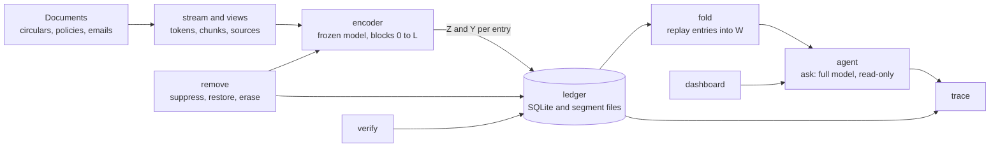

# Architecture: STARK

> How STARK is built. The what is in [PRD.md](PRD.md) and the why of the project is in [research.md](research.md). Section 16 lists every choice that differs from the approved project documentation, with the reason for each.
>
> **How to read this.**
> - Everyone: sections 1 to 6 and 16.
> - Module leads: also their module in sections 8 and 9, and the rules in section 11.
> - Coding agents: sections 8, 9, 11 and 14, plus the invariants in [AGENTS.md](../AGENTS.md).

## 1. The idea in one paragraph

STARK's state is a pure function of three inputs:

- the **stream** of documents read so far;
- the set of **hidden spans** (sources that have been suppressed or erased);
- the **run configuration**.

The learning layer W is computed from the **ledger**, and the ledger is a stored record of that function that can be partly recomputed. Every operation does one of three things:

- extends the stream (**read**);
- changes the hidden set (**suppress, restore, erase**);
- only reads the state (**ask, trace, verify**).

Reading has two stages:

1. **Encode:** run the frozen model to produce each chunk's addresses and teacher answers.
2. **Fold:** apply those numbers to W as matrix arithmetic.

Encoding never depends on W. That is why replay, tracing and removal can be exact.

## 2. Stack

- **Language and tools:** Python 3.10+, `uv`, ruff, pytest, pre-commit (see [AGENTS.md](../AGENTS.md)).
- **Model:**
  - `meta-llama/Llama-3.2-1B-Instruct`, open weights, run in bfloat16. It is gated on Hugging Face, so each member must accept Meta's licence once.
  - Fallback: `Qwen/Qwen2.5-1.5B-Instruct` (Apache 2.0).
  - Model sizes are always read from the model's config, never hard-coded.
- **ML:** PyTorch and Hugging Face Transformers. They are added to `pyproject.toml` when the encoder is written.
- **Reference maths:** numpy float64 in `src/stark/reference.py`. This is the oracle that every torch implementation is tested against.
- **Ledger storage:** SQLite for the index, and numpy `.npy` files opened as memory maps for the numbers.
- **Dashboard:** Streamlit, in Phase 5.
- **Experiment tracking:** Weights & Biases, for metrics and configuration only. Document text is never logged.
- **RAG baseline (Phase 3):**
  - a small open embedding model, chosen in Phase 3;
  - brute-force cosine search in numpy, which is enough for a stream of about 200 documents.
- **CI:** GitHub Actions, CPU only. GPU gates are run by hand on the NVIDIA laptop.

## 3. System flow



## 4. The learning layer

Llama 3.2 1B has 16 blocks, a hidden size of 2,048 and an MLP size of 8,192. The learning layer is `down_proj` of one block L. It is the matrix W, of shape `[d_out, d_in] = [2048, 8192]`.

- The input to `down_proj` is the **address** z (8,192 numbers).
- The output is the **content** y (2,048 numbers).
- Everything below `down_proj` in block L, and every block below L, is frozen. **So z never depends on W.**

**Starting point.** W starts at the pretrained `down_proj` weights, cast to float32. These are called `W_pre`.

**The teacher.** The teacher reads with a long view and the pretrained weights. Its answer for each token is `y = W_pre z_T`, where `z_T` is the address the long view produces. Y is computed in float32 at encode time and stored. **So Y never depends on W either.**

**One entry** covers a chunk of up to 64 tokens. The rows of `Z_i` and `Y_i` are tokens, padded with zero rows to exactly 64:

```
gap      E_i    = Y_i - Z_i W_{i-1}^T          [64 x d_out]
update   W_i    = W_{i-1} + beta_i E_i^T Z_i   [d_out x d_in]
step     beta_i = eta / ||Z_i||_F^2
```

This is Equation 2 of the documentation (TTCD's update), with token rows. Rearranged, it is the replay form, Equation 4:

```
W_i = W_{i-1} (I - beta_i Z_i^T Z_i) + beta_i Y_i^T Z_i
```

Three properties follow:

- **Zero rows do nothing.** A token whose Z and Y rows are zero changes nothing. Padding and hidden tokens are therefore zero rows, and every entry keeps the same fixed shape.
- **Each step is stable.** `||Z||_F^2` is at least the largest eigenvalue of `Z^T Z`. So `I - beta Z^T Z` has eigenvalues in `[1 - eta, 1]` whenever `0 < eta <= 1`, and no step can amplify what W already holds.
- **β never goes stale.** β depends only on Z, so a recorded β is still correct after any removal.

## 5. Views: what the student and the teacher see

Each view is computed as a **fresh, bounded pass** through the frozen model. It never uses a sliding-window mask over the whole stream: with a window of w tokens in each of the blocks up to L, information reaches about `(L + 1) x w` tokens back, so the true view would be far larger than w (decision D2).

**Paired blocks.** The pass that produces outputs for block k reads block k−1 and block k together, starting fresh:

```
stream:          ... | block k-2 | block k-1 | block k | block k+1 | ...
pass for k:                     [BOS][ block k-1 ][ block k ]
outputs kept:                                     [ block k ]
```

| | Teacher | Student |
| --- | --- | --- |
| Block size | T = 4,096 stream tokens | one chunk of 64 tokens |
| A token sees back | 4,096 to 8,192 tokens | 64 to 128 tokens |
| Crosses document boundaries | yes (this is how the leak happens) | no: the student never sees the previous document |
| Pass shape | 1 + 2T tokens, always | 1 + 128 tokens, always |
| Output kept | teacher addresses, turned into Y | student addresses Z |
| Passes per stream token | about 2 | about 2 |

**Rules for every pass:**

- The pass starts with a BOS token that never belongs to any source.
- Missing or short blocks are padding, masked out, so every pass has the same shape.
- A mask is always passed, even when nothing is hidden, so the same attention kernel runs every time.
- **Hiding a span** masks its tokens from attention in every block of the pass, and zeroes its own output rows. Token positions never shift.
- Chunks never cross a document boundary. The last chunk of a document may be shorter than 64 tokens and is padded with zero rows.

**Document text as the model sees it:** a short header followed by the body. The header gives the kind as the channel sees it (for example "Email"), the title and the date. The test-data label is metadata only and is never shown to the model.

**Which entries a source touches.** This is pure index logic in `views`, and needs no model. For an entry covering stream tokens `[a, b)` in chunk c of a document:

- **student view** = from the start of chunk c−1 (if it is in the same document, otherwise from a) up to b;
- **teacher view** = from the start of block(a)−1 up to b.

For a set of spans S:

| Case | What happens to the entry |
| --- | --- |
| Every real token of the entry is in S | delete it (an **own** entry) |
| Its student view overlaps S | re-encode Z and Y with S hidden |
| Only its teacher view overlaps S | re-encode Y with S hidden (this is the **leak**) |
| Anything else | unchanged, reapplied as recorded |

## 6. Operations

### 6.1 Read (learn)

1. **`stream`** adds the documents. It:
   - tokenises the header and body;
   - assigns stream positions;
   - splits each document into chunks;
   - records the spans: the document's own span, plus any tagged spans, such as one customer's details.
2. **`encoder`** runs the student passes to get Z, and the teacher passes to get the teacher addresses, then computes `Y = Z_T W_pre^T` in float32.
   - Encoding can run ahead over a whole batch of documents.
   - A teacher block that is only partly filled at the end of a batch is padded.
3. **`fold`** computes β from the stored Z.
4. **`ledger`** appends each entry, recording:
   - Z, Y and β;
   - the document;
   - the sources in each view.

   Every 100 entries it saves a float32 checkpoint of W.
5. **`fold`** applies the entry to W, using the values exactly as stored.

Live learning and replay therefore run the same function on the same numbers.

### 6.2 Ask

1. **Build the context.** It contains:
   - a fixed system prompt;
   - the most recent stream tokens, up to the answer window (default 8,192), with hidden spans masked;
   - the question.
2. **Run the full model** with W in place of block L's `down_proj`. The learning layer always computes in float32: z is cast up, and W is float32.
3. **Store** the answer, the ledger version, and the learning-layer addresses `q_t` of the question and answer tokens, which are needed for tracing.
4. **Ask never calls `fold` or `ledger.append`.** It only reads W.

### 6.3 Trace

For each traced position (the question and answer tokens), carry the address q backwards through the ledger, newest entry first:

```
r = q
for i = n down to 1:
    a_i = Z_i r                                   how much of the question still reaches entry i   [64]
    c_i = beta_i (Y_i - Z_i W_pre^T)^T a_i        entry i's contribution                           [d_out]
    r   = r - beta_i Z_i^T a_i
then    (W_n - W_pre) q = sum over i of c_i       exactly, up to float32 rounding
```

- **What a contribution means.** `c_i` is entry i's share of the learned part of the answer. It is zero when the teacher's answer equals what the pretrained layer would already give.
- **Why not the raw shares.** The documentation's raw shares, `beta_i Y_i^T a_i`, also give exact sums, but with real pretrained weights they credit entries for rewriting what the layer already held (decision D6). The two are identical when W starts at zero, as in the worked example.
- **Grouping by source:**
  - `sum over i in S of c_i = sum over i in S of beta_i Y_i^T a_i - W_pre u_S`, where `u_S = sum over i in S of beta_i Z_i^T a_i`.
  - So `W_pre` is multiplied once per source, not once per entry.

**From vectors to one score per source:**

1. **Score:**
   - `s_S = sum over t of g_t . C_{S,t}`.
   - `g_t` is the gradient of the answer's log-probability with respect to the learning layer's output at position t. It takes one backward pass through the blocks above L, with all weights fixed.
   - The scores of all sources add up to a first-order estimate of how far learning moved the answer.
   - Sources are ranked by score.
2. **Check:** for the top 3 sources, subtract `C_{S,t}` from the layer output at every traced position, rerun the blocks above L, and report the change in the answer's log-probability.

**Limitations in v1:**

- Only question and answer positions are traced. The learned change at earlier context positions also reaches the answer, but it is not attributed. Phase 2 measures how much this misses, by ablating over all positions.
- Tracing is exact only for the pretrained-weights teacher. The current-weights teacher variant keeps replay and removal exact, but not this additive split.

**Cost:** about 2.4 million operations per entry for each traced position. For 50 positions and 1,600 entries that is about 0.2 trillion operations: under a second on the GPU, and a few seconds on a laptop CPU.

### 6.4 Remove: suppress, restore, erase

| Operation | Hidden set becomes | Text kept | Can be undone | Who may do it |
| --- | --- | --- | --- | --- |
| suppress(S) | H ∪ S | yes | yes, by restore | compliance officer, data protection officer, admin |
| restore(S) | H \ S | yes | yes, by suppress | compliance officer, data protection officer, admin |
| erase(S) | H ∪ S | no | no | data protection officer, admin |

Steps:

1. **Check** the role, and log the request as an event.
2. **Work out the new hidden set** H′, and the affected entries (`views`, section 5).
   - Restore re-creates the entries that suppress deleted, so it needs the text. That is why only suppressed sources can be restored.
3. **Re-encode** the affected entries with H′, on the GPU. Only entries within about one teacher pair (2T tokens) after the source need the model.
4. **Write new versions** of the segments that changed. Unaffected entries are copied unchanged.
5. **Replay** from the checkpoint at or before the first affected entry to the end, writing a new version of every later checkpoint.
6. **Switch the ledger head** to the new version in one SQLite transaction, then delete the old segment and checkpoint files.
7. **Run the spot check** (section 6.5).
8. **Erase only:**
   - delete the source's stored text;
   - delete stored answers and traces that cite it;
   - mark the source as erased.

   The event log keeps only the record of the erase: source id, kind, date, actor, reason and the verification result.
9. **Log the result** as an event, with the report.

**Cost.** Re-encoding takes about `(2T + source length) / 64` entries, which is about 130 entries for T = 4,096. Folding from the checkpoint to the end is about 4.3 billion operations per entry. A full rerun re-encodes every entry.

**Single-entry deletion** is for diagnostics and the "delete only the source's own entries" baseline. It replays without the entry, or uses the one-step shortcut `W <- W - beta_i E_i U_i^T`, with `E_i` taken from the current replay. It is not a user operation, because it leaves the leak.

**Relation to the reference.** `remove` extends `reference.remove_source` in two ways:

- spans that cover only part of an entry, so the entry's Z is recomputed;
- restore.

The numpy reference gets the same extension first, with toy tests, before the torch version is written.

### 6.5 Verify

- **Spot check** (after every suppress, restore and erase):
  - Re-encode the first 4 entries after the end of the affected range, and 8 random unaffected entries. Their Z and Y must match the stored values bit for bit. The entries just past the range are where a wrong affected set would show first.
  - Replay the last segment from its new checkpoint. The result must equal the live W bit for bit.
- **Full check** (on demand, and in every RQ3 experiment):
  - Re-encode the whole stream with H′, replay from `W_pre`, and compare with the live W.
  - Report whether they are bit-identical, the largest absolute difference, the relative Frobenius difference, and the answers to the probe set.
- **Same environment only.** Both checks refuse to compare runs from different environments: GPU model, driver, CUDA, torch and transformers versions, all recorded in `run.json`.

## 7. The ledger

### Files

```
ledgers/<run_id>/                        gitignored and blocked by pre-commit
  run.json                               configuration and environment
  ledger.sqlite                          the index (tables below)
  stream/<doc_id>.txt                    the run's copy of each document's text
  segments/<seg>.v<ver>/
      Z.npy     uint16  [100, 64, d_in]  bfloat16 bit patterns of the student addresses
      Y.npy     float32 [100, 64, d_out] teacher answers
  checkpoints/<seg>.v<ver>.npy  float32 [d_out, d_in]   W before the segment's first entry
  answers/<answer_id>.npy       uint16  [m, d_in]       addresses of a stored answer, for tracing
```

- **Segments.** A segment holds 100 entries, which is also the checkpoint interval.
- **bfloat16 storage.** numpy has no bfloat16 type, so Z is stored as raw 16-bit patterns and viewed as `torch.bfloat16` when loaded. This is lossless.
- **Immutable files.**
  - Normal reading appends only to the newest segment.
  - A removal writes new versions of the segments it changes, and of every later checkpoint.
  - The old files are deleted once the head has switched.

**Sizes for Llama 3.2 1B:**

| Item | Size |
| --- | --- |
| Z per entry | 1 MiB |
| Y per entry | 0.5 MiB |
| One segment | 150 MiB |
| One checkpoint | 64 MiB |
| 100,000-token run (about 1,600 entries) | about 2.4 GiB of segments plus about 1 GiB of checkpoints |

Only runs that are traced or edited keep their ledgers.

### Tables

| Table | Columns | Notes |
| --- | --- | --- |
| `meta` | key, value | head version, config hash, hash of `W_pre` |
| `documents` | doc_id, seq, kind, title, issued_on, withdrawn_on, tok_start, tok_end, status | position of each document in the stream |
| `sources` | source_id, kind (document, customer, other), name, status (active, suppressed, erased) | every document is also its own source |
| `spans` | source_id, doc_id, tok_start, tok_end | a source is a set of spans |
| `entries` | entry_id, seq, version, doc_id, tok_start, tok_end, n_tokens, beta, segment, slot | one row per live entry; `beta` is the exact float32 value |
| `entry_sources` | entry_id, source_id, role (own, student, teacher) | which sources were in which view |
| `segments` | segment, version, first_seq, last_seq, path, checkpoint_path | the current version of each segment |
| `events` | event_id, at, actor, role, kind, source_id, reason, report_json | append-only audit log |
| `answers` | answer_id, at, question, answer, version, addresses_path, trace_json | stored answers, so they can be traced |

## 8. Modules

Each module starts as one file in `src/stark/` and becomes a package only when it outgrows one file (AGENTS.md). Leads follow the approved plan (Table 21 of the documentation).

| Module | Owns | Depends on | Lead | First needed |
| --- | --- | --- | --- | --- |
| `config` | constants (chunk 64, checkpoint every 100), run configuration, numerics setup | none | shared | Phase 1 |
| `stream` | documents, sources, spans, tokenising, stream positions, chunks | config | Riya | Phase 1 |
| `views` | student and teacher view ranges; the affected-entry sets | stream | Mitesh | Phase 1 |
| `encoder` | loading the model up to block L; student and teacher passes; hiding; Z and Y | stream, views | Mitesh | Phase 1 |
| `fold` | step size, update, replay, in float32 torch | config | Tahir | Phase 1 |
| `ledger` | SQLite index, segment files, checkpoints, versions, events | fold | Tahir | Phase 1 |
| `trace` | backward trace, contributions, scores, ablation check | ledger, agent | Tahir | Phase 2 (toy in Phase 1) |
| `remove` | suppress, restore, erase | views, encoder, ledger, fold | Pavan | Phase 2 (toy in Phase 1) |
| `verify` | spot and full checks | encoder, ledger, fold | Pavan | Phase 1 for replay, Phase 2 for removal |
| `agent` | the `Stark` facade; answering | all of the above | Mitesh | Phase 1 |
| `eval` | probes, scoring, metrics, the RQ1 to RQ3 runners | agent | Riya | Phase 1 |
| `baselines` | context-only, RAG, full reset, delete-own-entries, gradient ascent | agent, eval | Pavan | Phase 3 |
| `dashboard` | Streamlit app | agent | Riya | Phase 5 |

Boundaries that keep the maths exact:

- `encoder` only ever sees `W_pre`, never the live W.
- `fold` is the only code that changes W, and the same function serves live learning, replay and removal.
- `remove` is the only module that may write a new ledger version. During reading, the ledger is append-only.
- `agent.ask` never calls `fold` or `ledger.append`.
- `dashboard` uses only the `Stark` facade, never the ledger files.
- `fold`, `trace` and `remove` are each tested against `reference.py` on random small cases (float32 against float64).

**Scoring in `eval`.** Probes are scored by the log-probability of the answer options (for example "re-KYC is due" against "re-KYC is not due"), not by free generation. This is more reliable on a 1B model.

## 9. Interfaces

### Public: the `Stark` facade (`agent`)

```python
from stark import Document, RunConfig, Stark

stark = Stark.create("ledgers/run-001", RunConfig())  # new run; W starts at W_pre
stark = Stark.open("ledgers/run-001")  # resume a run

entry_ids = stark.read([doc_1, doc_2])  # encode, append, fold
answer = stark.ask("Is re-KYC due for a high-risk customer?")  # never changes W
trace = stark.trace(answer.answer_id, top_k=5)  # scores per source, contributions per entry

report = stark.suppress("doc-0042", actor="officer-1", role="compliance_officer", reason="...")
report = stark.restore("doc-0042", actor="officer-1", role="compliance_officer", reason="...")
report = stark.erase("cust-0007", actor="dpo-1", role="dpo", reason="DPDP erasure request")
check = stark.verify(report.event_id, mode="full")  # the spot check runs automatically

stark.sources()  # read-only queries for the dashboard
stark.entries(source_id="doc-0042")
stark.events()
```

There is no HTTP API in v1. The dashboard calls the facade in the same process.

### Internal contracts

```python
@dataclass(frozen=True)
class Document:  # stream
    doc_id: str
    # kind: rbi_circular, master_direction, internal_policy, branch_circular, complaint, email,
    # customer_record
    kind: str
    title: str
    issued_on: date
    text: str
    withdrawn_on: date | None = None
    spans: tuple[TaggedSpan, ...] = ()  # other sources inside the text, e.g. one customer
    test_data: bool = False  # metadata only; never shown to the model


@dataclass(frozen=True)
class EncodedChunk:  # encoder output, ledger input
    doc_id: str
    tok_start: int  # stream positions [tok_start, tok_end)
    tok_end: int
    n_tokens: int
    z: Tensor  # [64, d_in]  bfloat16; zero rows for padding and hidden tokens
    y: Tensor  # [64, d_out] float32; zero rows likewise
    student_view: tuple[int, int]
    teacher_view: tuple[int, int]
```

| Module | Main functions |
| --- | --- |
| `views` | `student_view(entry)`, `teacher_view(entry)`, `affected(entries, spans) -> Affected(delete, recompute_zy, recompute_y)` |
| `encoder` | `encode(stream, chunk_ids, hidden) -> list[EncodedChunk]` |
| `fold` | `step_size(z, eta)`, `apply(w, z, y, beta) -> w`, `replay(w_start, batches) -> w` |
| `ledger` | `append(chunk, beta) -> entry_id`, `read(seq_range)`, `checkpoint_at_or_before(seq)`, `write_version(...)` (only `remove` calls this), `log_event(...)` |
| `trace` | `trace(ledger, answer) -> Trace` |
| `remove` | `remove(ledger, encoder, spans, mode) -> RemovalReport` |
| `verify` | `spot(report) -> Check`, `full(report) -> Check` |

## 10. Configuration

| Setting | Starting value | Notes |
| --- | --- | --- |
| `model` | `meta-llama/Llama-3.2-1B-Instruct` | fallback `Qwen/Qwen2.5-1.5B-Instruct` |
| `learning_block` | 8 (of 0 to 15) | swept over 4, 6, 8, 10, 12 in Phase 1 |
| `CHUNK_TOKENS` | 64 | constant in `config.py` (AGENTS.md) |
| `CHECKPOINT_EVERY` | 100 entries | constant in `config.py` (AGENTS.md) |
| `teacher_block_tokens` | 4,096 | the teacher sees 4,096 to 8,192 tokens back; 256 to 512 on a laptop CPU |
| `eta` | 0.1 | swept over 0.03, 0.1, 0.3, 1.0 in Phase 1 |
| `teacher` | `pretrained` | variant `current` (TTCD's original): the ledger then also stores teacher addresses |
| `answer_context` | `recent`, 8,192 tokens | variant `question_only` |
| storage types | Z bfloat16, Y float32, W float32 | |

## 11. Exactness rules

These are the rules the exact-removal argument rests on. A change that breaks one needs a decision recorded in section 16 first.

1. **One learning layer.** Z comes only from frozen layers below it.
2. **The teacher always reads with `W_pre`**, never with learned weights, in any session.
3. **β depends only on Z,** with η fixed for the run.
4. **Same function, same numbers.** Live learning and replay use the same `fold.apply` on the same stored values: Z as computed in bfloat16, and Y in float32.
5. **Numerics:**
   - the learning layer always computes in float32;
   - TF32 is off (`torch.backends.cuda.matmul.allow_tf32 = False`, `torch.backends.cudnn.allow_tf32 = False`);
   - `torch.use_deterministic_algorithms(True)`;
   - `CUBLAS_WORKSPACE_CONFIG=:4096:8` is set in code before CUDA starts.
6. **Fixed shapes.**
   - Every student pass is 1 + 128 tokens and every teacher pass is 1 + 2T tokens.
   - Every entry is exactly 64 rows, with zero padding.
   - A mask is always passed.
7. **Hiding** means an attention mask plus zero output rows. Positions never shift, and BOS is never hidden.
8. **Same environment.** Exactness is only compared between runs with the same GPU model and software versions. Apple GPUs are never used for exactness checks or gate results.
9. **The ledger is append-only,** except through `remove`. Every removal is authorised, logged and verified.

**Levels of exactness:**

| What is compared | Required |
| --- | --- |
| Replay against live learning (Gate 1) | bit-identical |
| Removal against a full rerun (Gate 2) | target bit-identical; if our GPUs cannot give that after re-encoding, a tolerance is agreed at Gate 2 and reported |
| Hidden against deleted (position effect) | measured, not required |

## 12. Hardware: what runs where

The team has one NVIDIA laptop (Mitesh's), two Macs and one Windows laptop. A workplace GPU can be requested; confirm its memory with `nvidia-smi`.

| Work | Machine |
| --- | --- |
| Reference maths, `fold`, `ledger`, `trace` and `remove` on toy and random data; all CPU tests | any laptop |
| Encoder unit tests | any laptop, CPU, using a tiny randomly initialised Llama built inside the test (no download) |
| Smoke runs of the real model on a few hundred tokens | any laptop, on CPU; Apple GPU allowed for speed, never for results |
| Data pipeline, `eval` code, dashboard | any laptop |
| Full runs, timing, and the Gate 1 and Gate 2 exactness checks | the NVIDIA laptop; the workplace GPU for long runs |

The Windows laptop counts as a CUDA machine only if its card is NVIDIA (to confirm).

**GPU memory on 6 GB** (estimates):

- **Encoding** puts only the embeddings and blocks 0 to L on the GPU: about 0.8B parameters, or 1.6 GB, at L = 8. A teacher pass of 8,193 tokens fits with PyTorch's memory-efficient attention.
- **Answering** needs the full model (about 2.5 GB), a key-value cache for 8,192 tokens (about 256 MiB) and W in float32 (64 MiB).

**Time** (estimates, to be checked by timing one run in month 1):

- **Encoding** costs about four token passes per stream token, through blocks 0 to L only.
- **Replay** costs 4.3 billion operations per entry. A replay of 1,600 entries (about 7 trillion operations) should take seconds on the NVIDIA laptop and tens of seconds on a laptop CPU.

## 13. Constraints

- **Scale:**
  - streams of about 200 documents and 100,000 tokens;
  - one process and one writer per run;
  - about 3.5 GiB per kept ledger.
- **Determinism over speed:** no TF32, no non-deterministic kernels and fixed shapes, even where that is slower.
- **Privacy:**
  - no real personal data;
  - no document text in W&B or logs;
  - after an erase, no copy remains under the run folder;
  - tokens are read from environment variables (`HF_TOKEN`, `WANDB_API_KEY`), and neither code nor agents read `.env` files.
- **Not needed in v1:**
  - an HTTP API, login or multi-user access;
  - GPUs in CI;
  - model downloads in tests;
  - languages other than English.

## 14. Repository layout

Target layout. Folders appear only when they have real content.

```
src/stark/
  reference.py      float64 oracle (exists)
  config.py         constants, run configuration, numerics setup
  stream.py         documents, sources, spans, tokenising, chunks
  views.py          view ranges and affected-entry sets
  encoder.py        frozen model up to block L; Z and Y
  fold.py           step size, update, replay (float32)
  ledger.py         SQLite index, segments, checkpoints, versions, events
  trace.py          contributions, scores, ablation check
  remove.py         suppress, restore, erase
  verify.py         spot and full checks
  agent.py          the Stark facade; ask
  eval/             probes, scoring, RQ1 to RQ3 runners
  baselines/        Phase 3
  dashboard/        Phase 5
tests/              CPU tests, run in CI
tests/gpu/          GPU gates, marked and run by hand
experiments/        run configurations for RQ1 to RQ3
data/  ledgers/  outputs/    gitignored, and blocked by pre-commit
```

## 15. Build order to Gate 1

The order is chosen so that the whole pipeline works end to end on a toy first. Then each part is swapped for the real one, and integration happens every week instead of at the end.

1. **Walking skeleton on the toy** (CPU, everyone):
   - `config`;
   - `fold` in float32 torch, tested against `reference.py`;
   - `ledger` storing the toy entries;
   - `trace` and `remove` on the toy, through a fake encoder that returns the toy's Z and Y;
   - one end-to-end test: read the four sentences, trace Q1, suppress S3, and verify against the run that never saw it.

   This proves the interfaces fit before anyone touches the model.
2. **Tiny model on CPU:**
   - `stream`, `views`, and `encoder` on a tiny random Llama.
   - A property test: after hiding any random span, entries outside the affected set re-encode bit for bit.
   - Removal equals a full rerun on the tiny model.
3. **Real model on the NVIDIA laptop:**
   - load Llama 3.2 1B up to block L;
   - encode a short stream;
   - time the encode and the fold, and measure memory;
   - check that replay equals live learning bit for bit. This is **Gate 1(a)**.
4. **First benchmark slice** (starts in parallel with step 1): about 50 documents, with probe questions about text beyond the window.
5. **Learning against context-only** on those probes, sweeping the block and η. This is **Gate 1(b)**.
6. **Gate 1 report.**

During steps 3 to 5, removal and spot verification move from the toy to the tiny model and then to the real model, so Gate 2 work starts early.

## 16. Decisions: changes from the approved documentation

| # | The documentation said | Now | Why |
| --- | --- | --- | --- |
| D1 | One online update per chunk (Figure 3) | Reading is two stages: encode, then fold | Z and Y never depend on W, so model work and arithmetic separate. The blocks above L are not needed while reading, live learning and replay are the same code, and one encoding serves many η settings. The maths is unchanged |
| D2 | Teacher and student views through sliding-window attention masks (Table 17) | Each view is a fresh pass over paired blocks (section 5) | Stacked sliding windows reach about (L + 1) × w tokens back, so the recorded "sources in view" would be wrong and removal would not be exact. Fresh passes make the view exactly what a token depends on, at about two passes per token |
| D3 | The teacher reads with W as at the start of the session | The teacher always reads with `W_pre` | If a later session started from learned weights, every teacher answer would depend on every earlier source, and removing an old source would need a full rerun |
| D4 | Step size β per entry, value not fixed | β = η / ‖Z‖²_F | It depends only on Z, so the recorded β stays correct after removal, and no step can amplify W. `tests/test_properties.py` already uses this form |
| D5 | Ledger stores Z, Y and the gap E, all in 16-bit | Z in bfloat16 and Y in float32; E is not stored | E is derived and goes stale after any earlier removal: in the worked example, deleting E3 changes E4's gap from −0.45 to −0.9. Rounding Y to 16-bit leaves a gap of about 0.2% even when the student agrees with the teacher, and that noise would be written into W at every entry. Size per entry stays at 1.5 MiB |
| D6 | Trace shares `β Y (Zᵀ r)`, plus what is left of the starting weights | Contributions to the learned change, `(W_n − W_pre) q` | With real pretrained weights, raw shares credit entries for rewriting what the layer already held. The contribution is zero when teacher and student agree. Identical to the documented numbers when W starts at zero, as in the worked example |
| D7 | Removals "can be reviewed and undone" (Table 22) | Suppress (can be undone) and erase (cannot) are separate | Undoing needs the data, which conflicts with DPDP erasure |
| D8 | A source is a document | A source is a named set of spans; chunks and student views stay inside one document | One customer's data is spread across many documents. Keeping chunks inside documents means a document source's own entries can simply be deleted |
| D9 | Replay from the nearest checkpoint | Removal also writes new versions of every later checkpoint and deletes derived copies | Every checkpoint after the source carries its influence. For an erase, they are derived personal data |
| D10 | Every removal is checked against a rerun | A spot check after every removal; full reruns on demand and in every RQ3 experiment | A full rerun costs what removal is meant to save. Removal can only differ from a rerun if the affected set is wrong, and the spot check targets exactly that |
| D11 | Deterministic kernels, 32-bit learning layer | Adds TF32 off, the cuBLAS workspace setting, fixed pass shapes, masks always passed, and the environment recorded and checked | Each of these can change the last bits of a result between two runs that should match |
| D12 | Llama 3.2 1B | The Instruct variant; model sizes read from the config | Answering questions needs the instruction-tuned model. Reading sizes from the config makes the fallback a configuration change |
| D13 | Planned layout `learner/`, `ledger/`, `trace/`, `remove/`, `dashboard/` (first README draft) | The modules in section 8, one file each to start | The encode and fold split puts views and the update rule on different sides. AGENTS.md asks for one file per module until it outgrows it |

## 17. Open questions

These are settled by measurement in Phase 1 unless marked otherwise. Each result updates section 10 or 16.

1. **Which block hosts the learning layer.** Sweep blocks 4, 6, 8, 10 and 12 on the first benchmark slice.
2. **The step-size constant η.** Sweep 0.03, 0.1, 0.3 and 1.0.
3. **Answer context:** the recent window, or the question alone.
4. **Precision when answering.** The learning layer computes in float32, but the rest of the model runs in bfloat16. Measure whether small learned changes survive bfloat16 rounding in the blocks above L, or whether answering needs those blocks in float32.
5. **Bit-identity after re-encoding** on our GPUs, including a teacher block that was partly filled when first encoded and then re-encoded when full. If it is not bit-identical, agree a tolerance at Gate 2.
6. **Position effect** of hiding a source instead of deleting it. Measured in Phase 2.
7. **RAG baseline:** the embedding model and passage size. Phase 3.
8. **Gradient-ascent baseline:** steps and learning rate on W only. Phase 3.
